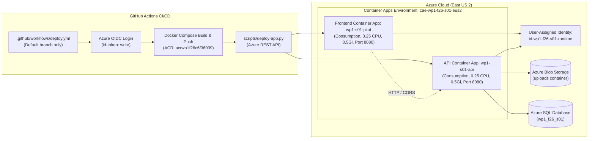

# wp1-fall26-azure

A production-ready Azure Container Apps deployment showcase for Web Programming 1, featuring independent .NET 10 frontend and API microservices with Azure Blob Storage, Azure SQL Database, and GitHub Actions OIDC federation.

---

## Architecture Overview



---

## App Configuration & Settings

| Resource | Value | Notes |
| :--- | :--- | :--- |
| **Frontend App Name** | `wp1-s01-pilot` | Pilot student frontend app |
| **API App Name** | `wp1-s01-api` | Student backend API app |
| **Port** | `8080` | `ASPNETCORE_HTTP_PORTS=8080` |
| **Workload Profile** | `Consumption` | Serverless on-demand scaling |
| **Revision Mode** | `Single` | Single active revision |
| **Replica Scale** | `min: 0, max: 1` | Scale to zero when idle |
| **Resources** | `0.25 CPU, 0.5Gi RAM` | Default lab allocation |
| **Authentication** | GitHub OIDC (`id-token: write`) | No client secrets in GitHub |

---

## Solution Layout

```text
wp1-fall26-azure/
├── .github/
│   └── workflows/
│       └── deploy.yml          # GitHub Actions deployment workflow
├── api/
│   ├── Services/
│   │   └── UploadStore.cs      # Azure Blob Storage upload/download client
│   ├── Dockerfile              # Multi-stage .NET 10 API Dockerfile (port 8080)
│   ├── Program.cs              # Minimal API endpoints (/health, /api/status, /api/sql-check)
│   └── api.csproj              # .NET 10 project with Azure Identity, Blobs, SqlClient
├── frontend/
│   ├── Pages/                  # Razor Pages UI & Cloud Dashboard
│   ├── Dockerfile              # Multi-stage .NET 10 Frontend Dockerfile (port 8080)
│   ├── Program.cs              # Razor Pages setup and /health endpoint
│   └── frontend.csproj         # .NET 10 Razor Pages web project
├── scripts/
│   └── deploy-app.py           # Azure Container Apps ARM REST deployment script
├── compose.yml                 # Docker Compose multi-service build/run configuration
├── wp1-fall26-azure.slnx       # .NET 10 solution file
└── .gitignore                  # Excludes bin/, obj/, .vs/, and credential files
```

---

## Local Development

### 1. Build Solution
```powershell
dotnet build wp1-fall26-azure.slnx
```

### 2. Run API
```powershell
dotnet run --project api/api.csproj --urls "http://localhost:5180"
```

### 3. Run Frontend
```powershell
dotnet run --project frontend/frontend.csproj --urls "http://localhost:5000"
```

### 4. Local Container Testing
```powershell
docker compose up --build
```
- Frontend: `http://localhost:8080`
- API: `http://localhost:8081`

---

## Deployment Workflow

1. Pushes to the repository's default branch (`main`) trigger `.github/workflows/deploy.yml`. Pushes to feature branches automatically skip deployment.
2. The workflow performs zero-secret authentication via Azure OIDC (`azure/login@v2`).
3. Images are built and pushed to Azure Container Registry (`acrwp1f26c6f36039.azurecr.io`).
4. `scripts/deploy-app.py` submits the ARM resource update using the Azure REST API, attaching the runtime identity (`id-wp1-f26-s01-runtime`) and configuring the SQL connection string secret on the API app.
5. GitHub Actions polls `az containerapp show` until `latestRevisionName == latestReadyRevisionName` and provisioning state is `Succeeded`.
